# ネフィルガの見た目の試作（10-7a）の前後

画質「高」・同じ構図（怪獣を決まった位置・状態に置き、決まったカメラで撮る）。左が変更前（9-6a〜10-5b の見た目）、右が変更後。
撮り方: `node scripts/kaiju2-visual-pilot.js <before|after> [--measure] [--quality low|high]`（`?dev=k2shot`。場面は `src/data/kaiju2-shots.ts`）。
クラウドには GPU が無く、ソフトウェアの描画で撮った絵（ブルーム・影は本物と同じ式だが、色の細かい違い・ちらつきは実機で確かめる）。

## 昼・快晴

| 場面 | 変更前 | 変更後 |
| --- | --- | --- |
| 登場（下から見上げる。演出の場面の中ほどの構図） | 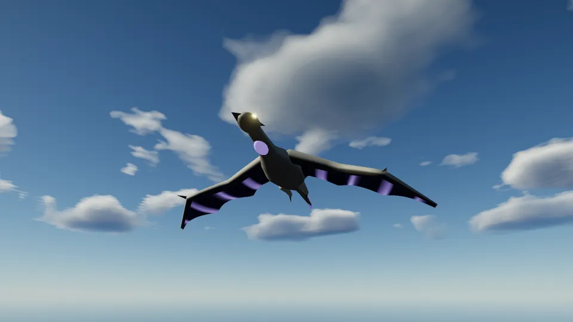 |  |
| 周回（横から） |  |  |
| 雷球の予兆（喉と膜の筋が光る） | 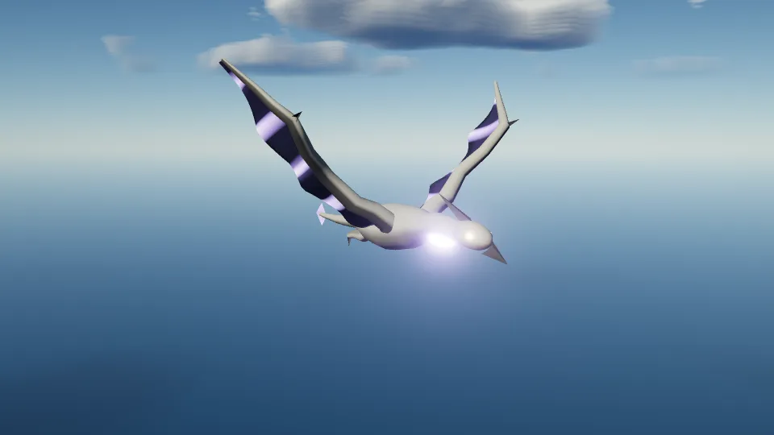 | 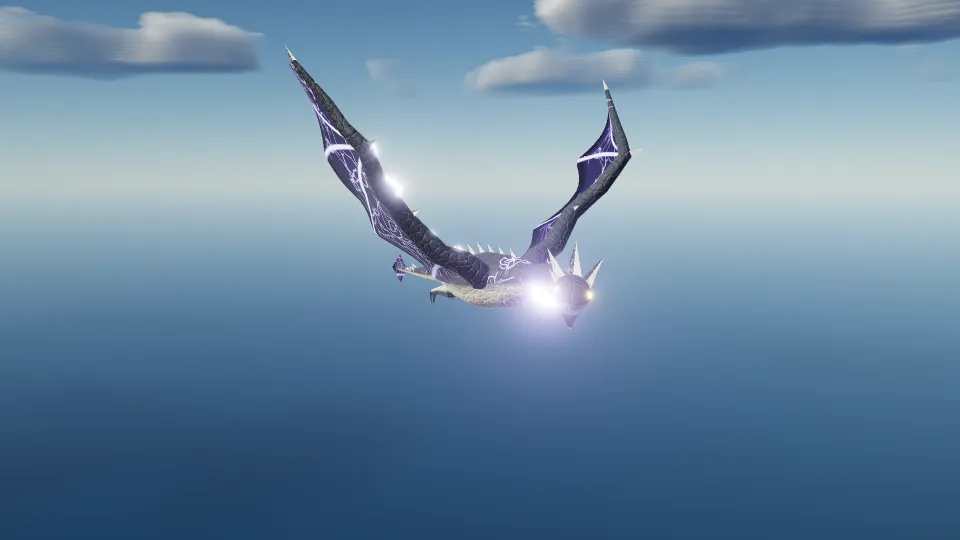 |
| 止まり木（翼をたたんで休む） | 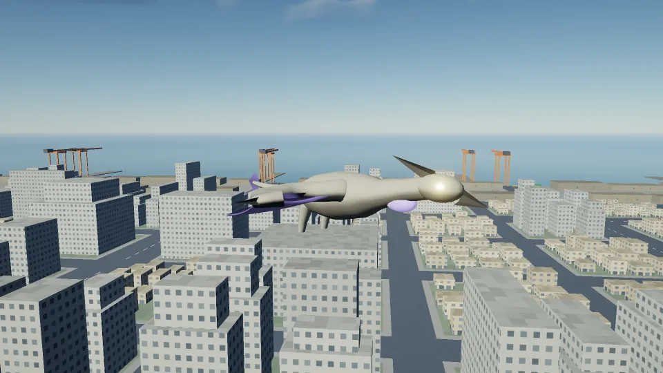 |  |
| 部位の破壊（右翼を壊した直後） | 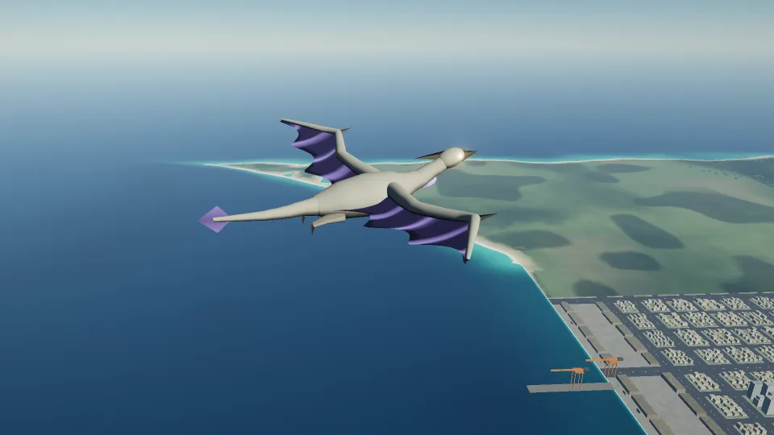 |  |
| 撃破（墜ちていく） |  |  |

## 嵐（昼・雨）

| 場面 | 変更前 | 変更後 |
| --- | --- | --- |
| 登場（下から見上げる。演出の場面の中ほどの構図） | 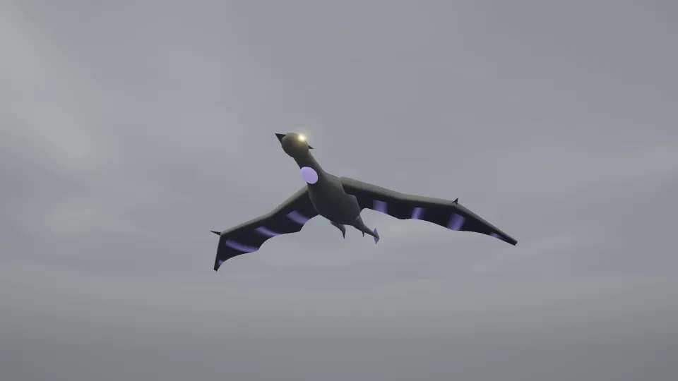 |  |
| 周回（横から） | 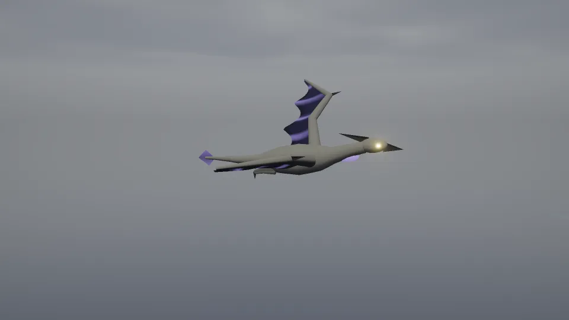 | 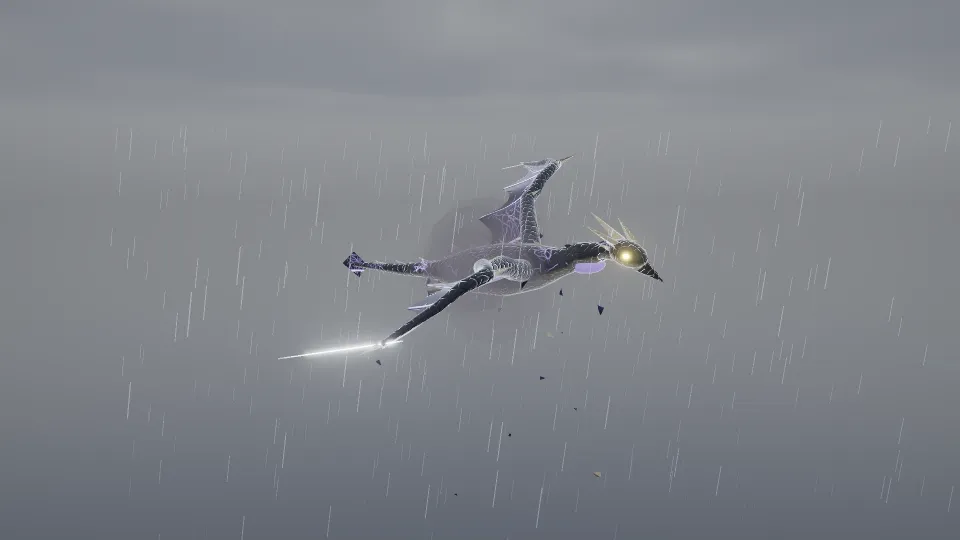 |
| 雷球の予兆（喉と膜の筋が光る） |  | 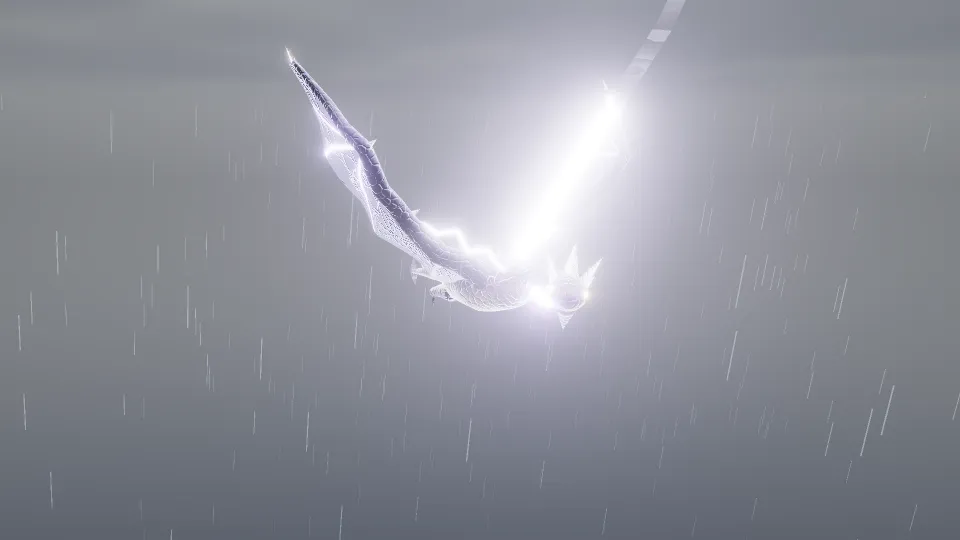 |
| 止まり木（翼をたたんで休む） | 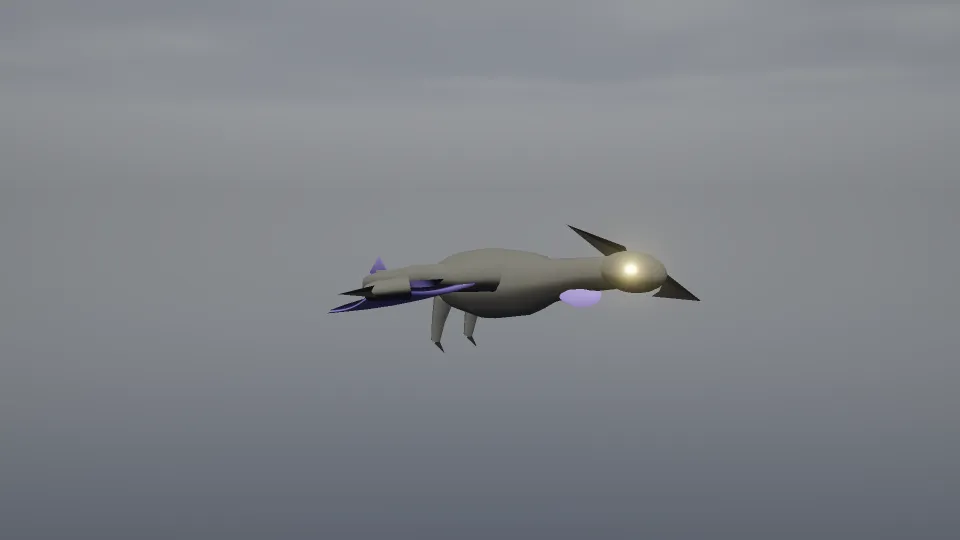 | 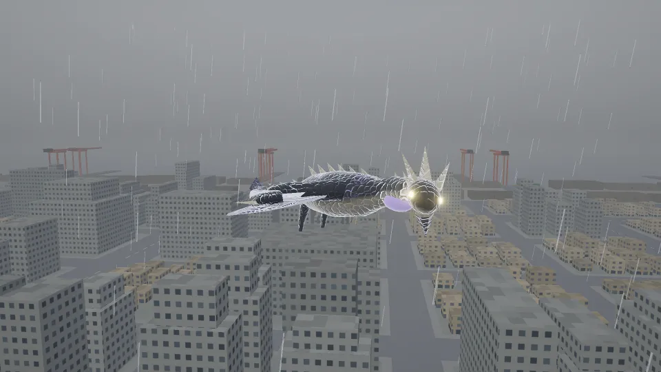 |
| 部位の破壊（右翼を壊した直後） | 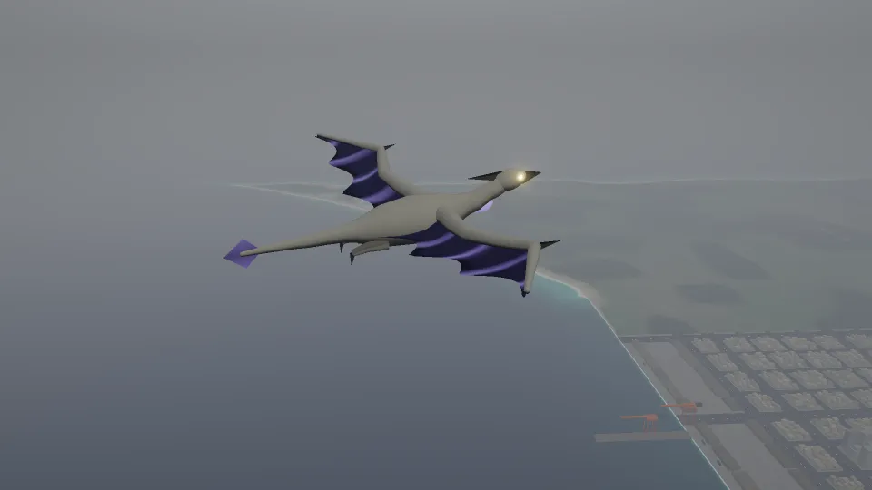 |  |
| 撃破（墜ちていく） | 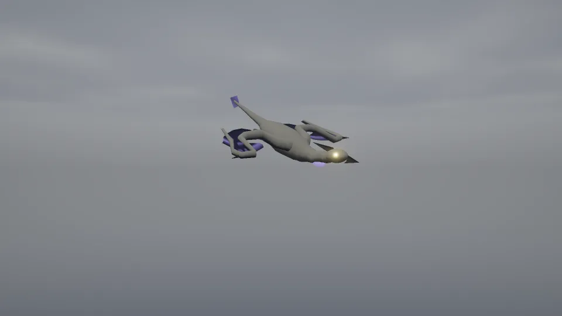 | 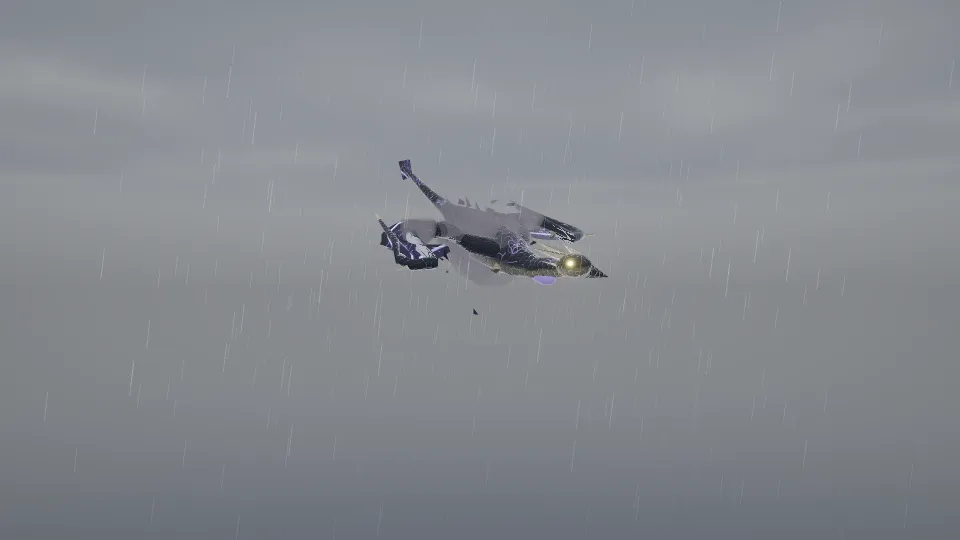 |

## 重さ（怪獣だけ。怪獣を出して / 隠して描いた差）

場面ごとの値は `before-high.json` / `after-high.json` / `before-low.json` / `after-low.json`（嵐の空で測った）。draw call・三角形はシャドウの分を含む（画質「高」はシャドウあり、「低」はなし）。

| | 低 変更前 | 低 変更後 | 高 変更前 | 高 変更後 |
| --- | --- | --- | --- | --- |
| 体の三角形（モデル） | 1,282 | 1,282 | 5,110 | 5,192（角・とげ・爪 +82） |
| 描いた三角形（場面の最小〜最大） | 1,282 | 1,282〜2,290（撃破の破片と煙） | 10,220 | 11,644〜14,796（雨・風の筋・弧・破片・煙） |
| draw call（場面の最小〜最大） | 2 | 2〜4（撃破の破片と煙） | 4 | 5〜10（体 4 + 雨と風 1・弧 1・破片 2・煙 1。出ているときだけ） |
| 作る絵（縮めた絵を含む） | 0 | 0 | 0 | 2.7MB（512 × 512 × 2 枚。「中」は 256 で 0.7MB） |
| 形を動かす時間（JS・中央値） | 0.1ms 未満 | 0.1〜0.2ms | 0.1ms 未満 | 0.2ms |
| 1 フレームの時間（ソフトウェアの描画・目安） | 約 270〜470ms | 約 250〜310ms | 約 1,040〜1,860ms | 約 1,190〜1,840ms |
| 怪獣の分の描く時間（ソフトウェア・目安） | −12〜126ms | −11〜10ms | −33〜58ms | −43〜85ms |

- 描く時間はクラウドのソフトウェアの描画（GPU なし）で、1 フレームに 0.3〜2 秒かかり、ばらつき（± 50ms ほど）が怪獣の分より大きい。前後で目に見える差は無いが、実機の GPU での重さは実機で確かめる（設定の「デバッグ表示」の fps・draw call）
- 起動の量（タイトルまでに読む JS・CSS）: gzip 290.4KB → 290.4KB（変わらない。上限 320KB）。ネフィルガの遅延チャンク `kaiju2-runtime`: JS gzip 10.1KB → 21.1KB・CSS 0.9KB → 1.2KB（ネフィルガを選んだときだけ読む）
- 絵は起動時（ネフィルガのチャンクを読んだとき）に作る。画質を変えると作り直す（同じ大きさは使い回す）
